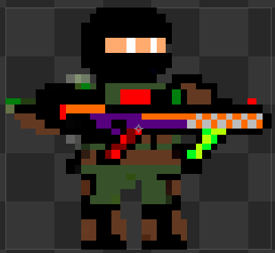

# Sprites

- Sprites: 5 direções (→ ↗ ↑ ↘ ↓)
- Esquerda: usar flip/espelhamento

## Player (tiro em 5 direções)

## Checklist

- [ ]  Idle
- [ ]  Run
- [ ]  Jump/Fall
- [ ]  Shoot (5 direções)
- [ ]  Hit
- [ ]  Death

## Organização

| Item | Pasta/Arquivo | Status | Observações |
| --- | --- | --- | --- |